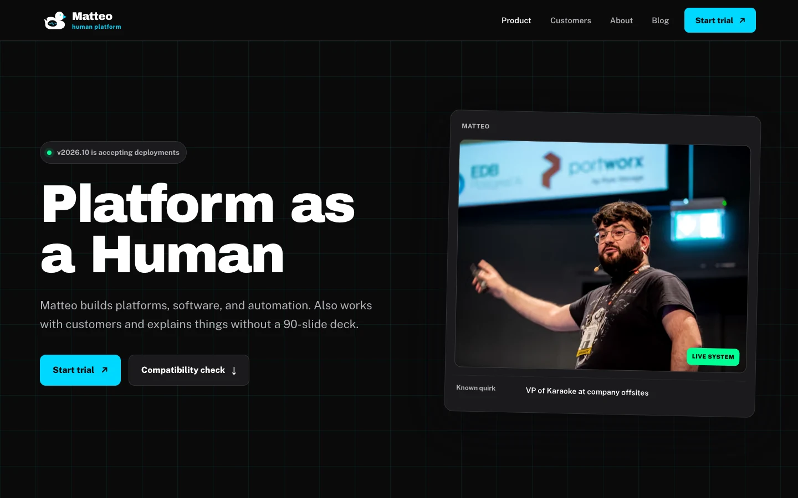
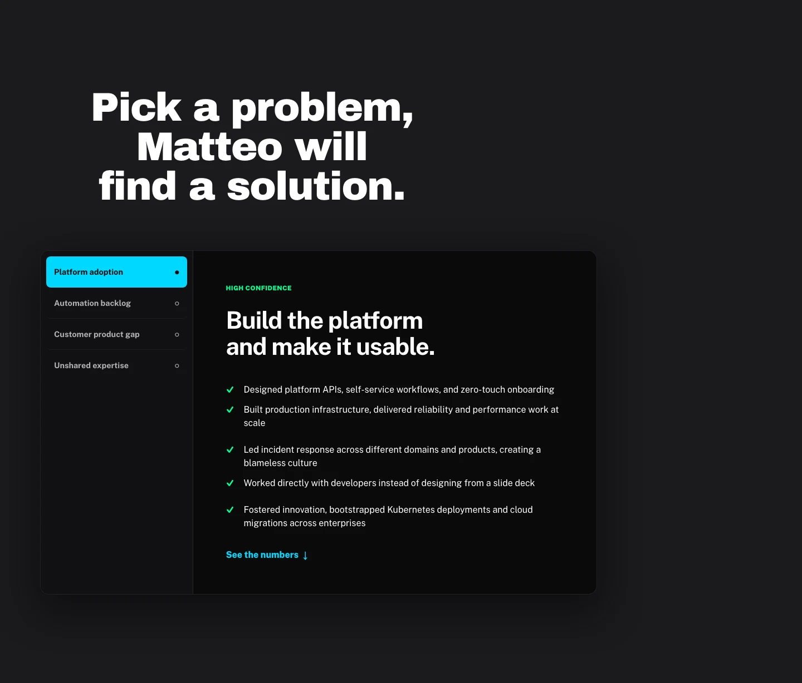

<picture>
  <source media="(prefers-color-scheme: dark)" srcset="src/assets/brand/matteo-logo-mono-light.svg">
  
</picture>

# Matteo: the human platform


[Website](https://mbianchi.dev) · [Documentation](docs/README.md) ·
[Issues](https://github.com/mbianchidev/mbianchi.dev/issues) ·
[Changelog](https://mbianchi.dev/roadmap/)



*The current app, captured from its local production export.*

<details>
<summary>See the compatibility lab</summary>



</details>

A personal portfolio disguised as an overconfident startup launch. The
"product" is Matteo Bianchi; the engineering work, open-source contributions,
talks, and delivery history behind it are real.

The site gives hiring teams, collaborators, and curious engineers a way to
inspect that work. The startup language is parody, not a SaaS product.

**Contents:** [Quick start](#quick-start) · [Why Matteo](#why-matteo) ·
[How it works](#how-it-works) · [Get started](#get-started) ·
[Features](#features) · [Documentation](#documentation) ·
[Project policies](#project-policies) · [License](#license)

## Quick start

Use **Node.js 20.9+ on the Node 20 line** and **npm** to match CI. Git and
network access are required for packages and build-time Google Fonts downloads.
No database, container runtime, API key, or `.env` file is needed.

```bash
git clone https://github.com/mbianchidev/mbianchi.dev.git
cd mbianchi.dev
npm ci
npm run dev
```

Open [http://localhost:3000](http://localhost:3000) to see the portfolio.
Visit `/blog/` for writing or `/pricing/` to try the quote calculator.

## Why Matteo

The joke gets attention. Source code, talks, and delivery history back it up.
The portfolio connects platform engineering, software, customer work, and
automation without turning them into another corporate resume.

## How it works

Next.js 15.5 App Router, React 19, strict TypeScript, and CSS Modules turn local
Markdown and structured data into pre-rendered HTML. Browser interactions add
filters, diagnostics, and calculated quotes. Production serves static files,
not a Next.js server.

[Architecture and limitations](docs/architecture.md)

## Get started

[Development and commands](docs/development.md) ·
[Content and configuration](docs/content.md) ·
[Build and deploy](docs/development.md#static-export-and-deployment)

## Features

- **Inspectable work:** capability and integration manifests, open-source
  evidence, customer history, and career milestones.
- **Searchable content:** a Markdown blog, career filters, and data-driven role
  descriptions.
- **Interactive tools:** compatibility diagnostics and an accessible
  rate-by-hours quote calculator.
- **Shareable pages:** configurable public links, short-link fallbacks, a resume
  download, social previews, and responsive local images.
- **Fictional status:** seeded incidents, postmortems, and calculated
  availability, clearly separate from real monitoring.

## Documentation

[Documentation index](docs/README.md) ·
[Development, CI, and deployment](docs/development.md) ·
[Content, blog, and links](docs/content.md) ·
[Status simulation](docs/status.md) ·
[Repository layout and scope](docs/architecture.md)

## Project policies

[AI-assisted maintenance](docs/development.md#ai-assisted-maintenance) ·
[Contributing](CONTRIBUTING.md) ·
[Agent instructions](AGENTS.md) ·
[Code of Conduct](CODE_OF_CONDUCT.md) ·
[Accessibility](ACCESSIBILITY.md) ·
[Support](SUPPORT.md) ·
[Security](SECURITY.md)

## License

[The Unlicense](LICENSE)
